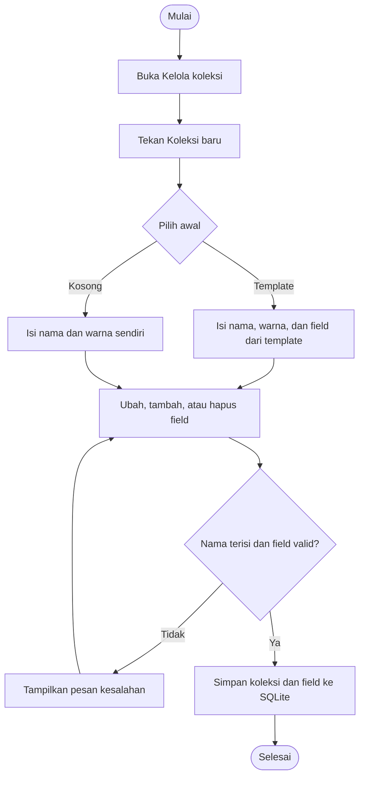
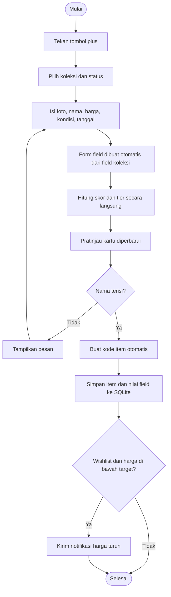
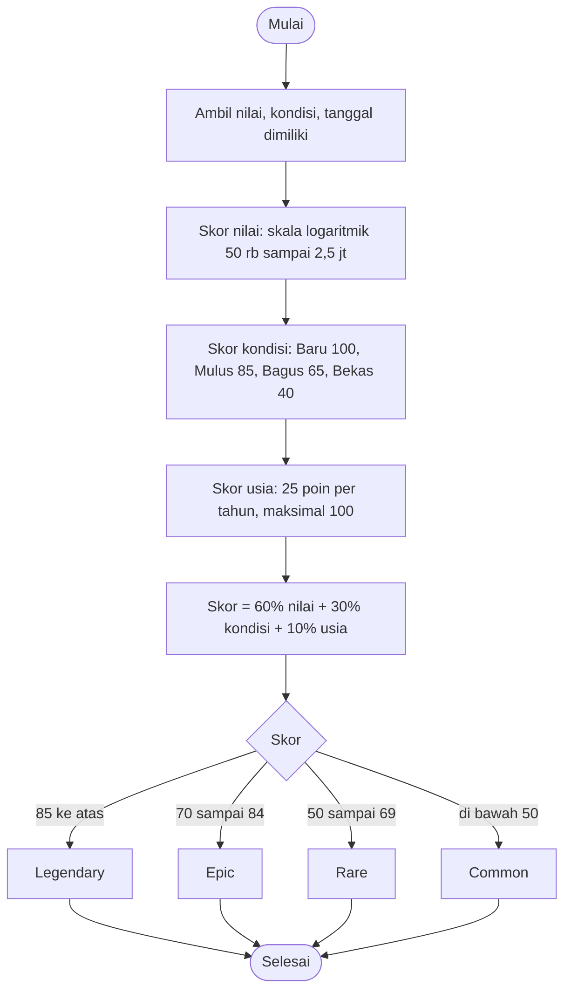
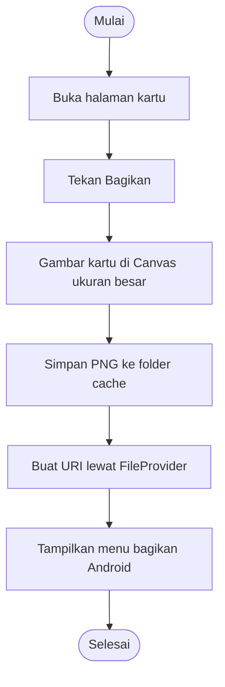
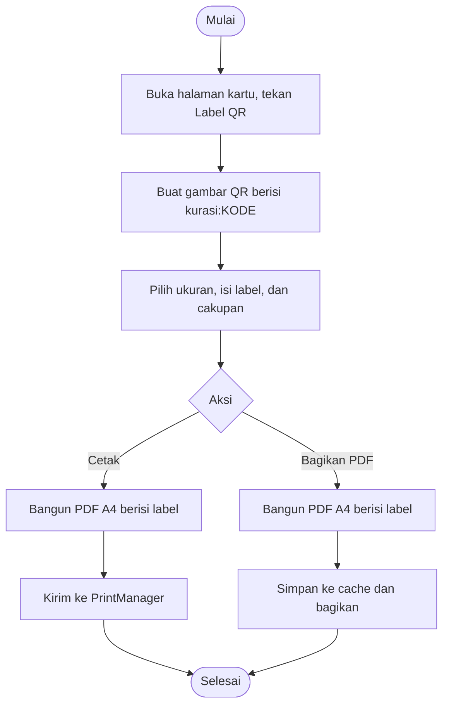
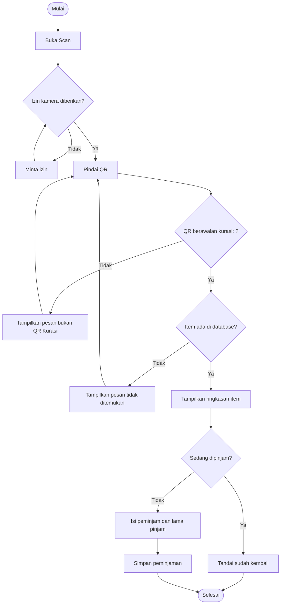
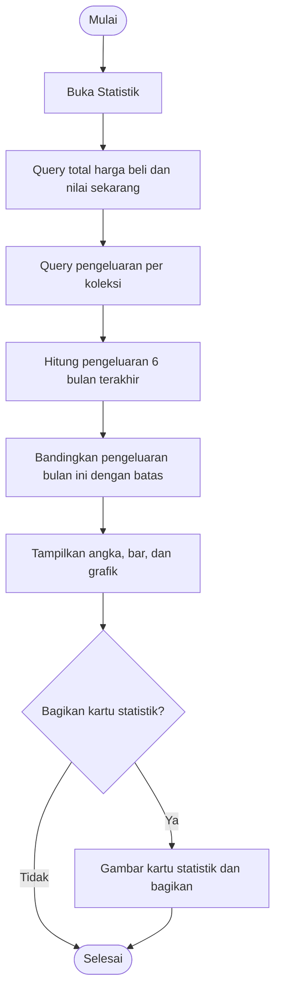
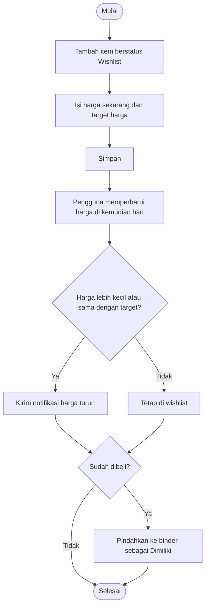
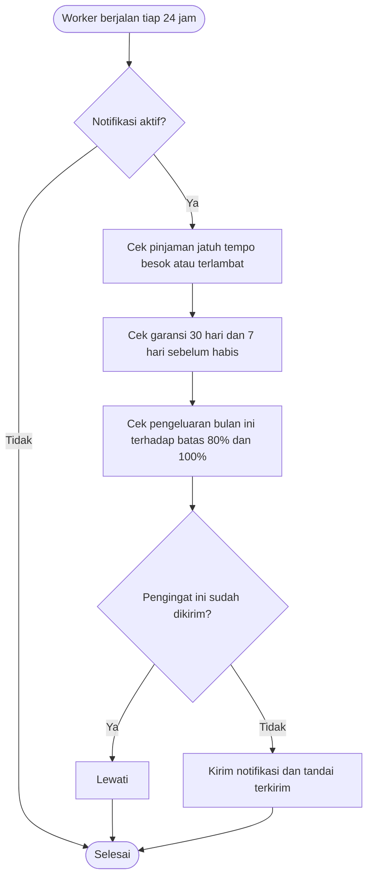
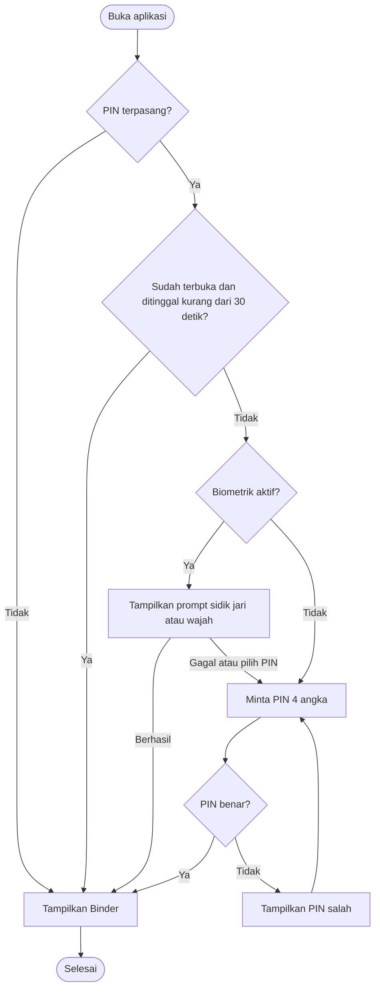

# Activity Diagram Kurasi

Diagram ditulis dalam Mermaid (tampil otomatis di GitHub dan banyak editor Markdown). Untuk laporan, gambar ulang
dengan notasi UML activity diagram (lingkaran awal, kotak aksi, belah ketupat keputusan, lingkaran akhir),
atau ekspor langsung dari mermaid.live.

## 1. Membuat koleksi (template atau kustom)

## 2. Menambah item dan membuat kartu

## 3. Menghitung skor dan tier

## 4. Membagikan kartu

## 5. Membuat dan mencetak label QR

## 6. Scan QR dan mencatat peminjaman

## 7. Menghitung dan menampilkan statistik

## 8. Wishlist dan notifikasi target harga

## 9. Pengingat harian (WorkManager)

## 10. Membuka aplikasi dengan PIN

